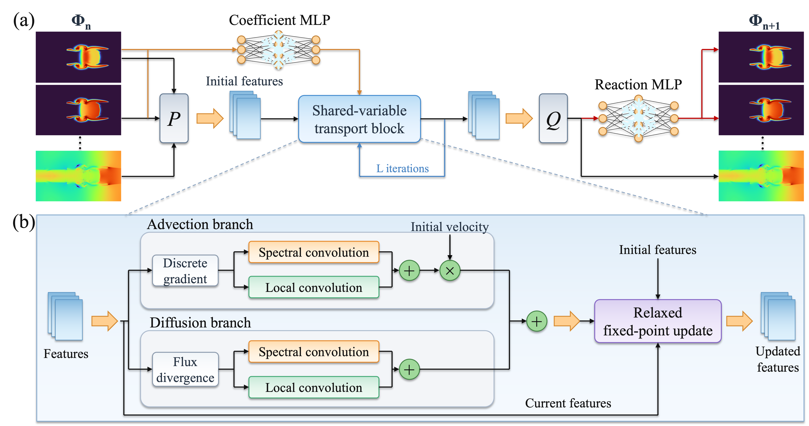

# PDE-Structured Transport Operator (PSTO)

Code for **PSTO: PDE-structured transfer learning for Multiscale convection–diffusion–reaction systems with shared implicit updates**, by Kaiwen Li, Dezhi Zhou and Xingcai Lu.

PSTO learns transport from reaction-free data and couples it with a reaction solver or neural surrogate. A transport block shared across physical variables is reused in relaxed fixed-point iterations. Comparisons include FNO, U-Net and U-FNO.



## Cases and results

| Case and instructions | Time step | Coupled rollout | Reference result |
|---|---|---|---|
| [Canonical CDR](cases/cdr/README.md) | `2.5e-4 s` | 100 steps | [Fields](cases/cdr/figures/2d_CDR.png) · [PDE residual](cases/cdr/figures/pde_residual_analysis.png) |
| [Robertson counterflow](cases/robertson/README.md) | `1e-4 s` | 100 steps | [Fields](cases/robertson/figures/2d_Robertson.png) · [OOD visualization](cases/robertson/figures/inference_transfer.png) |
| [Hydrogen planar jet flame](cases/tripleflame/README.md) | `1e-6 / 1e-5 s` | 100 / 10 steps | [Fields](cases/tripleflame/figures/2d_Tripleflame.png) · [Accuracy and cost](cases/tripleflame/figures/computational_performance_timestep.png) |

Each case contains model code, training, evaluation and plotting scripts, pretrained checkpoints, reference figures, and data-preparation instructions. See also the [training curves](docs/figures/training_curves.png).

```text
cases/{CDR,Robertson,Tripleflame}/
  src/ utils/          # Models, training and evaluation
  scripts/ analysis/   # Run scripts and analysis
  data/                # Generators, OpenFOAM cases and data instructions
  checkpoints/         # Pretrained transport and auxiliary models
  figures/             # Reference PNGs from the experiments
docs/figures/          # Architecture and training curves
```

Python-based numerical solver for `CDR`, OpenFOAM solver & dicts for `Robertson`, `Tripleflame` are included.

## Installation

Local checks use Linux and Python 3.12:

```bash
python3.12 -m venv .venv
source .venv/bin/activate
python -m pip install --upgrade pip
python -m pip install -r requirements.txt
```

For GPU use, select a compatible [PyTorch build](https://pytorch.org/get-started/locally/). CFD generation requires OpenFOAM 6 and the dependencies listed in each data guide.

## Data and evaluation

1. Prepare the inputs using the [CDR](cases/cdr/data/README.md), [Robertson](cases/robertson/data/README.md) or [flame](cases/tripleflame/data/README.md) data guide. CDR uses Burgers input from [PeRCNN](https://github.com/Raocp/PeRCNN).
2. Evaluate the bundled models from the corresponding case directory:

   ```bash
   # CDR or Robertson
   bash scripts/test.sh
   bash scripts/plot.sh

   # Flame: use 1e-6 or 1e-5 consistently
   bash scripts/test.sh --dt 1e-6
   bash scripts/plot.sh --dt 1e-6
   ```

Reference data are needed for initial conditions, normalization and error evaluation. The case guides include training commands, CPU options and lightweight tests. Saved reference figures can be viewed without running the models.

The bundled checkpoints and figures come from the conducted experiments. Reported accuracy uses the arithmetic mean of physical-variable relative L2 errors.

## Attribution and licensing

See [third-party notices](THIRD_PARTY_NOTICES.md) for upstream code and data sources. A project-wide open-source license has not been selected; retained third-party licenses continue to apply to their files.
