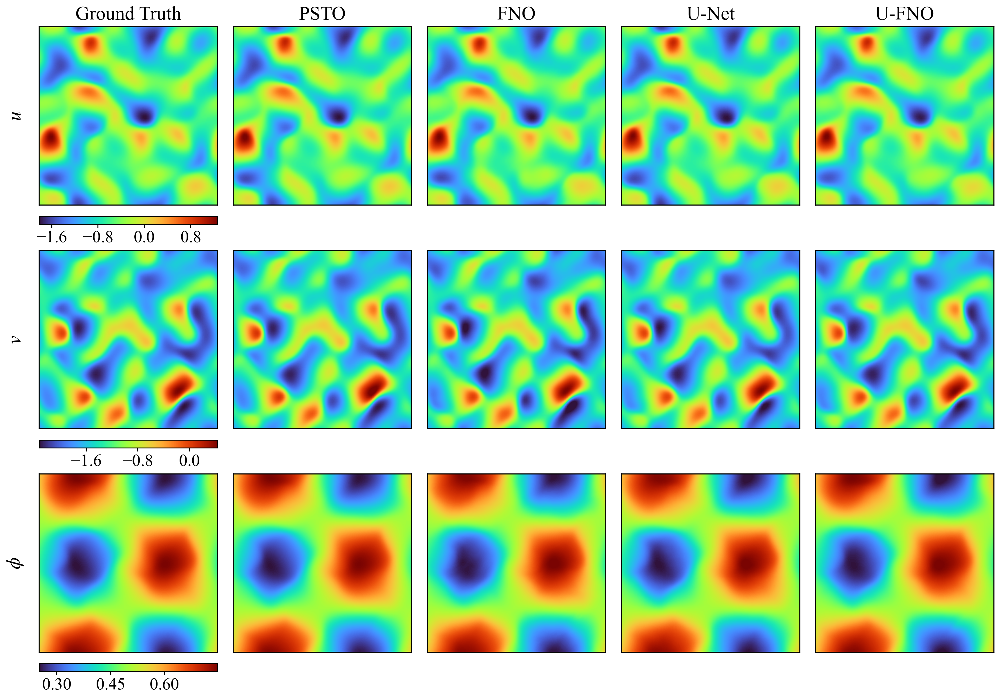

# Canonical convection–diffusion–reaction case

PSTO learns reaction-free transport for `u`, `v` and `phi`, then couples it with
polynomial reaction terms. The reference case uses a periodic 100×100 grid,
`dt = 2.5e-4 s` and 100 autoregressive steps.



Original experiment figures: [relative error](figures/relative_l2.png),
[spatial error](figures/spatial_errors_CDR.png),
[PDE residual](figures/pde_residual_analysis.png).

## Evaluate the supplied models

Install the [repository dependencies](../../README.md) and run from this directory.
PSTO, FNO, U-Net and U-FNO weights are in
`checkpoints/models/model_<MODEL>/checkpoint_best.pt` (`MODEL` is `PSTO`, `FNO`,
`Unet` or `UFNO`). Reference data are still required; follow
[data preparation](data/README.md), then run:

```bash
python -B data/numer.py
bash scripts/test.sh
bash scripts/plot.sh
```

Evaluation starts from the reacting initial state and writes local
`analysis/figures/rollout.npz`, `comparison.csv` and PNG figures. The score is
mean variable-wise relative L2 error in physical units. Standard plots require
all four model predictions. For a short CPU check:

```bash
bash scripts/test.sh --device cpu --models PSTO --steps 1 --save_dir /tmp/psto_cdr_check
```

The default reference index is 1 for HF and 200 for `--dataset lf` (one-based).
Use `--data_idx` to choose another window. Saved PNGs can be viewed directly;
regenerating them requires a local evaluation.

## Train new models

Use a separate output directory to retain the supplied checkpoints:

```bash
TRAIN_OUTPUT_ROOT=checkpoints/retrained bash scripts/train.sh PSTO
# Replace PSTO with FNO, Unet or UFNO for a baseline.
```

Defaults retain the 100-epoch schedule: PSTO uses four processes and 2,500
microsteps; baselines use one process and 10,000 microsteps, with batch size 16
per process and gradient accumulation 2. Additional CLI arguments follow the
model name. For one-process PSTO, use `NPROC_PER_NODE=1` and `--n_iters 10000`.
Changing parallelism can change optimization even when the example count agrees.

## Tests

```bash
python -B -m unittest discover -s tests -p test_physics_loss.py -v
```

These analytic physics-loss tests require no experimental data. New datasets,
logs and prediction arrays remain local; bundled weights and PNGs are archived
experimental artifacts, not results of retraining this release.
