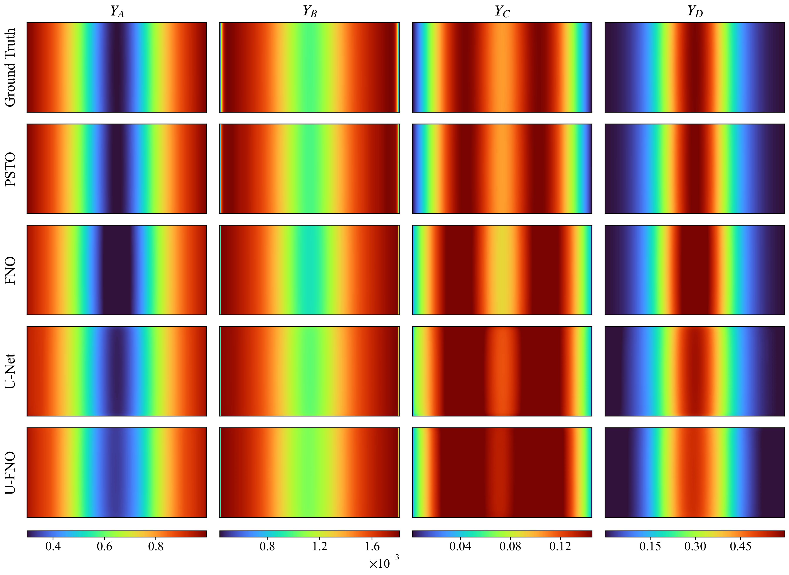

# Robertson counterflow

The transport surrogate predicts four species mass fractions conditioned on
velocity. Coupled evaluation uses `dt = 1e-4 s`, Strang splitting and the
adaptive SDIRK2 reaction backend for 100 steps.



Original experiment figures: [relative error](figures/relative_l2.png),
[spatial error](figures/spatial_errors_Robertson.png),
[anchored stages](figures/anchored_stage_evidence.png),
[distribution comparison](figures/inference_transfer.png).

## Evaluate the supplied models

Install the [repository dependencies](../../README.md), generate the LF/HF
inputs using [data/README.md](data/README.md), and run from this directory:

```bash
bash scripts/test.sh
bash scripts/plot.sh
```

The four checkpoints are in
`checkpoints/models/model_<MODEL>/checkpoint_best.pt`, where `MODEL` is `PSTO`,
`FNO`, `Unet` or `UFNO`. Evaluation begins at HF frame index 1001 and uses
`gpu_sdirk2`; no Assimulo installation is needed for this default. Set
`DEVICE=cpu` for CPU execution or `TEST_MODELS=PSTO` for a single-model check.
Standard comparison plots require all four outputs.

`TEST_SAVE_DIR` selects the local evaluation output directory;
`PLOT_DIRECTORY` and `PLOT_STEP` select plotting inputs. The default is
`analysis/figures`. Evaluation generates CSV/NPZ arrays and PNG figures; existing
bundled PNGs can be viewed without running these commands.

## Train new models

```bash
TRAIN_OUTPUT_ROOT=checkpoints/retrained bash scripts/train.sh PSTO
# Replace PSTO with FNO, Unet or UFNO for a baseline.
```

The default uses four GPU processes, batch size 16 per process, gradient
accumulation 2 and 2,500 microsteps, presenting 40 epochs of examples.
`NPROC_PER_NODE` changes the process count; the default microstep count is
`10000 / NPROC_PER_NODE`. `N_ITERS` overrides that count. Additional training CLI options
follow the model name. Use a new output directory to preserve the supplied
experimental weights; matching epochs alone does not guarantee identical training.

## Analysis and tests

```bash
python -B analysis/analyze_anchored_stages.py --device cpu
python -B -m unittest discover -s tests -p 'test_*.py' -v
```

Anchored-stage diagnostics need the PSTO checkpoint and LF validation data.
The tests generate tiny temporary fields and need no datasets or OpenFOAM.

`analysis/analyze_distribution_shift.py --input local.json` plots supplied
`embedding`, `indices.lf` and `mmd` values. The t-SNE/MMD computation and historical
JSON are not included; the bundled distribution PNG is an original result.
