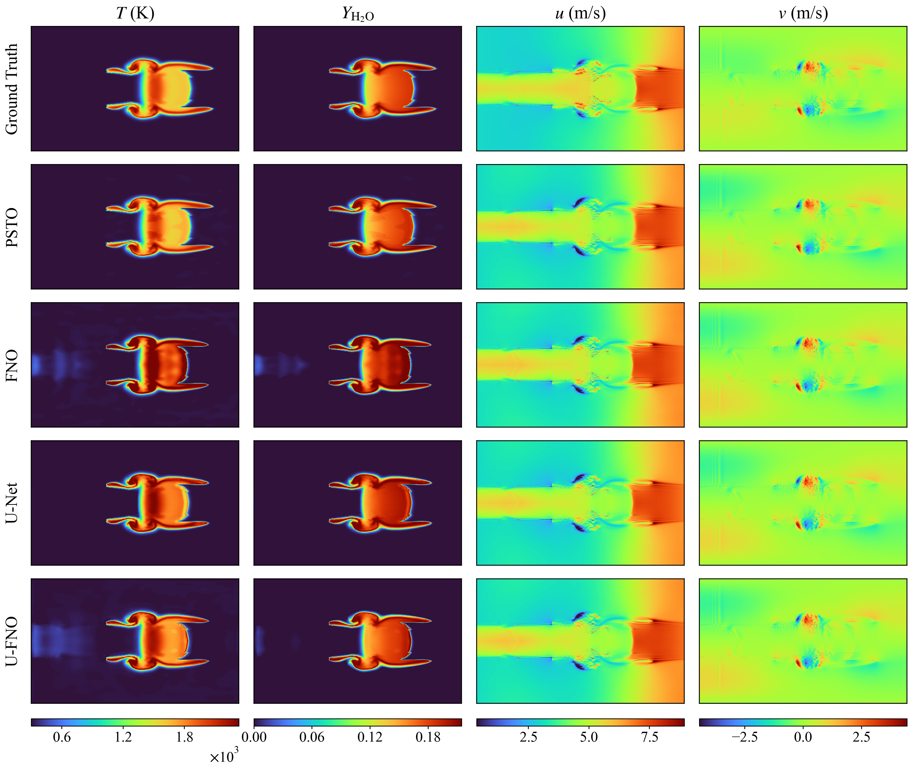

# Planar hydrogen jet flame

The transport models predict temperature, nine species mass fractions and
velocity, coupled to a species MLP with enthalpy-based temperature recovery.
The main experiment uses 100 updates of `1e-6 s`; the larger-step experiment
uses 10 updates of `1e-5 s` over the same physical horizon.



Original experiment figures: [spatial error](figures/spatial_errors_PlanarJet.png),
[channel errors](figures/channel_relative_l2_step100.png),
[coupled sensitivity](figures/coupled_sensitivity_error.png),
[accuracy and runtime](figures/computational_performance_timestep.png).

## Evaluate the supplied models

Install the [repository dependencies](../../README.md) and prepare local
reference data following [data/README.md](data/README.md). Run from this directory:

```bash
bash scripts/test.sh --dt 1e-6 --device cuda
bash scripts/test.sh --dt 1e-5 --device cuda
bash scripts/plot.sh --dt 1e-6
bash scripts/plot.sh --dt 1e-5
```

Transport checkpoints for `PSTO`, `FNO`, `Unet` and `UFNO` reside in
`checkpoints/models/model_<MODEL>/` for `1e-6 s` and
`checkpoints/models_1e-5/model_<MODEL>/` for `1e-5 s`. Each interval has its own
`model_DNN/dnn_model_Y.pt`; the constitutive model is
`checkpoints/models/model_coeff/constitutive_DNN_BCT.pt`. Keep the supplied
`checkpoints/inference_config.json` with these weights. Transport and reaction
weights must match the chosen interval.

The default one-based starting index is 2001. `HF_DATA_FILE` selects the reacting
reference HDF5 used for evaluation and reference-range statistics.
`DATA_IDX` changes the starting frame.
`TEST_SAVE_DIR` selects a new output directory; defaults are `analysis/figures`
and `analysis/results_1e-5/lie_10`. Coarse evaluation rejects an existing output
directory. Use `--device cpu` for CPU evaluation or `--dry-run` to inspect a command.

Bundled PNGs are original results and can be viewed directly. New metrics and
plots require local evaluation data; necessary inference metadata accompanies
the weights, while historical training logs and prediction arrays are excluded.

## Train new models

Use new output directories to preserve the supplied checkpoints:

```bash
TRAIN_OUTPUT_ROOT=checkpoints/retrained_fine bash scripts/train.sh --dt 1e-6 --model PSTO
TRAIN_OUTPUT_ROOT=checkpoints/retrained_coarse bash scripts/train.sh --dt 1e-5 --model PSTO
```

Replace `PSTO` with `FNO`, `Unet` or `UFNO` for a baseline. The default recipe uses
effective batch 32, approximately 40 epochs and 100 warmup optimizer updates:
one process, batch 4, accumulation 8 and 40,000 microsteps. `TRAIN_NPROC=4`
changes accumulation to 2 and microsteps to 10,000. Validation defaults to a
fixed temporal subset of at most 256 pairs; `TRAIN_MAX_VAL_PAIRS=0` selects the
full validation split. `TRAIN_DATA_FILE` overrides the local transport training input. This recipe is not asserted to recover every historical
checkpoint's training trajectory.

Auxiliary training is available through `scripts/run.py source --dt ...` and
`scripts/run.py constitutive --dt 1e-6`, after preparing their required inputs.
Use separate `TRAIN_OUTPUT_ROOT`/`COEFFICIENT_CHECKPOINT` paths for new models.
When evaluating new transport weights, also set `SOURCE_CHECKPOINT` to the
intended reaction model for the same interval. All launchers support `--dry-run`.

## Tests and analyses

```bash
python -B -m unittest discover -s tests -p test_paired_data.py -v
python -B -m unittest discover -s tests -p test_pde_velocity.py -v
python -B -m unittest discover -s tests -p test_inference_bundle.py -v
```

The first two suites use generated inputs. The bundle tests load the supplied
weights on CPU and check configuration validation. `test_lie_1e5.py` additionally requires
local reaction data. Operator diagnostics in `analysis/analyze_operators.py`
need transport-only and exact reaction reference trajectories; their generation
is among the documented data-preparation gaps. For local timing experiments,
see [performance measurements](analysis/performance/README.md).
